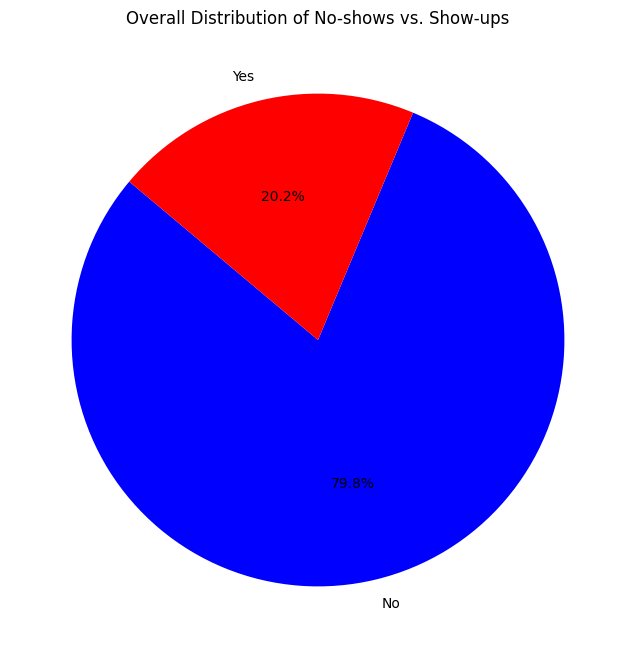
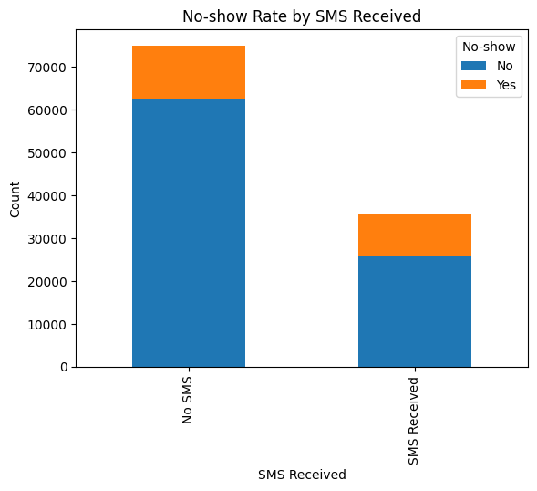
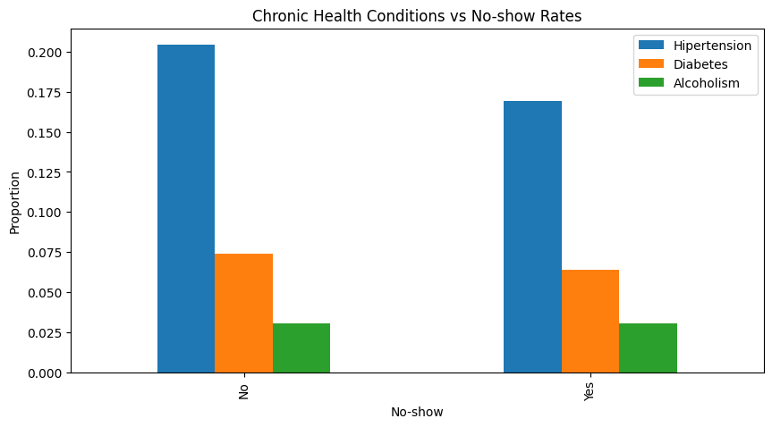

# Investigate a Dataset: Medical Appointment No-Shows

This project was completed as part of Udacity's Data Analyst Nanodegree. It uses data from about 100,000 medical appointments in Brazil to look at which factors are linked to patients missing appointments.

The analysis is in [`Investigate_a_Dataset.ipynb`](Investigate_a_Dataset.ipynb). The appointments dataset is not included in this repository.

## Questions

1. What share of patients miss their appointments?
2. Does age affect no-shows?
3. How does receiving an SMS reminder relate to attendance?
4. How do gender and SMS reminders relate to attendance together?
5. How do chronic conditions relate to no-shows?
6. Does the neighborhood affect no-shows?

## Method

- Converted the scheduling and appointment dates to datetime format.
- Checked the data and calculated descriptive statistics.
- Ran a chi-square test on SMS reminders and no-shows.
- Compared groups with pie, box, and stacked bar charts.

## Findings

**Overall:** 79.8% of patients attended and 20.2% did not.

**SMS reminders:** The chi-square test found an association between SMS reminders and no-shows (chi-square = 1,766, p < 0.01). In the chart, the group that received an SMS has a larger share of no-shows. This does not show that the SMS caused it, because the data does not explain why patients received a reminder.

**Age:** The age distributions are similar for both groups. The median age is slightly higher among patients who attended.

**Chronic conditions:** Hypertension is less common among patients who missed appointments, at about 17% compared with about 20% among those who attended. Diabetes follows a similar pattern, and alcoholism is about the same in both groups.

**Neighborhood:** Most neighborhoods have similar attendance rates. One stands out with a much higher no-show rate.

## Limitations

- The dataset does not include the reasons patients missed appointments.
- These results show associations, not causes.

## Tools

Python, pandas, NumPy, Matplotlib, SciPy, Jupyter Notebook
